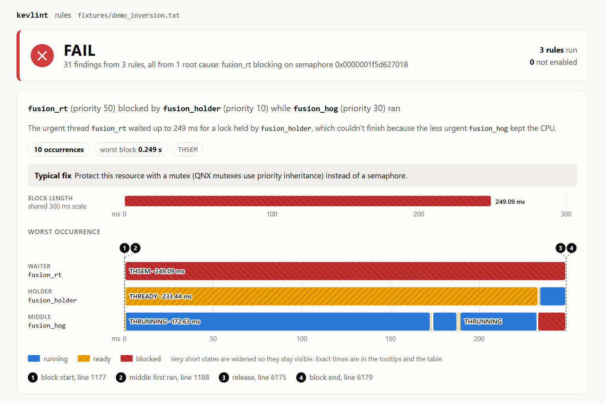
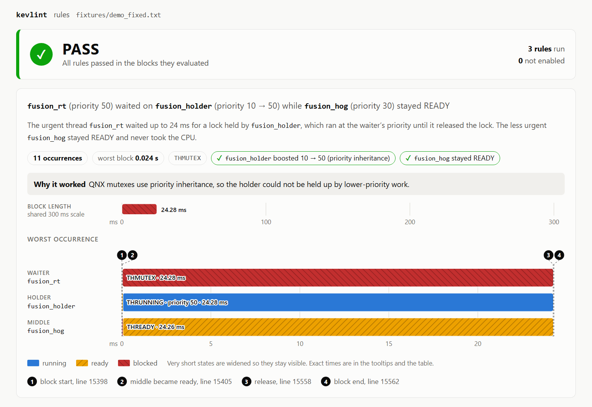

# kevlint

kevlint turns QNX 8.0 kernel traces into pass/fail CI checks. It records a trace from
a QNX target, or reads one already decoded, and checks it against structural timing
rules such as "a priority 50 thread must not wait behind an unrelated priority 30
thread". A violation exits non-zero, so the build fails. Every finding cites the exact
trace lines behind it, and every PASS says how many blocks it could not evaluate. An
optional LLM explains violations from those same lines, and can never change the
verdict.

**Before:** `fixtures/demo_inversion.txt`. The urgent thread waits behind unrelated work.



**After:** `fixtures/demo_fixed.txt`. The holder is boosted from priority 10 to 50.



These images are cropped to the verdict and the worst occurrence, and the full reports have
more. The two reports come from the same demo workload, recorded on QNX 8.0 under QEMU. A
priority 10 thread holds a lock that a priority 50 thread needs, while a priority 30
thread hogs the CPU. The only change is the lock.

| With `kevlint.toml` | Before: semaphore | After: priority-inheritance mutex |
|---|---|---|
| All 3 rules | FAIL, 31 findings | PASS, 0 findings |
| Worst `fusion_rt` block | 249.1 ms | 24.3 ms |
| Exit status | 1 | 0 |

The durations are QEMU timings, so only their contrast means anything.

## Why this matters

Priority inversion has caused real failures. In 1997 the Mars Pathfinder lander, running
VxWorks, kept resetting itself on Mars: a low-priority task held a mutex that a high-priority
task needed, while medium-priority tasks kept running. The fix was to enable priority
inheritance on that mutex. The team had seen the problem before landing but could not get it to
repeat ([Glenn Reeves's account](https://www.cs.cornell.edu/courses/cs614/1999sp/papers/pathfinder2.html)).

Bugs like this are easy to miss in normal testing, because the system still works, just late,
and only when the timing lines up. Teams building automotive, medical and industrial products
on QNX need timing checks they can repeat on every change.

Commercial tools already do automated timing verification and list QNX support on their product
pages: [Vector TA Tool Suite](https://www.vector.com/en/product/ta-tool-suite/),
[INCHRON chronVIEW](https://www.inchron.com/chronview/) and
[GLIWA T1](https://www.gliwa.com/products/t1timing/t1posix/). kevlint does not replace them, and
we have not compared it with them. It is a small, open-source, CI-native complement with three
rules, built on QNX semantics. It reads the instrumented kernel's trace directly, can budget
time in message-passing states such as `THSEND` and `THREPLY`, and recognizes priority
inheritance when a holder is boosted.

Where those tools are commercial products, kevlint makes the core check free and automatic:
every pull request can check a recorded trace for high-priority threads held up by
lower-priority work, and say exactly what it evaluated.

**Contents:** [Quick start](#quick-start) ·
[How it works](#how-it-works) ·
[Rules and config](#rules-and-config) ·
[`kevlint capture` and `kevlintd`](#kevlint-capture-and-kevlintd) ·
[AI explanations](#ai-explanations-and-their-safeguards) ·
[Validation](#validation) ·
[Limitations](#honest-limitations) ·
[Evidence of QNX use](#evidence-of-qnx-use) ·
[License](#license) ·
[Architecture](docs/architecture.md) ·
[Reference](docs/reference.md)

## Quick start

### Run it locally

This needs Python 3.11 or newer, with no packages to install and no QNX tools. Decoded traces
from a real QNX 8.0 target are committed in `fixtures/`.

```sh
git clone https://github.com/Adedayoke/kevlint.git
cd kevlint
export PYTHONPATH=host

python3 -m kevlint check fixtures/demo_inversion.txt --config kevlint.toml --html before.html
echo "exit status: $?"    # 1: violations found

python3 -m kevlint check fixtures/demo_fixed.txt --config kevlint.toml --html after.html
echo "exit status: $?"    # 0: no violations

python3 -m unittest discover -s host/tests -t host
```

Open `before.html` and `after.html` in a browser. Each is one self-contained file.

### Use it in CI

CI checks a committed `traceprinter` text file, recorded with `tracelogger -w`. It does not need
QNX on the runner.

```yaml
steps:
  - uses: actions/checkout@v7

  - uses: Adedayoke/kevlint@v0.1.0
    with:
      trace: traces/my_system.txt
      report: reports/my_system.html
      config: kevlint.toml

  - uses: actions/upload-artifact@v7
    if: always()
    with:
      name: kevlint-report
      path: reports/my_system.html
```

A violation fails the job, and a results table goes to the job summary.
[PR #1](https://github.com/Adedayoke/kevlint/pull/1) shows a failing build. It is **red on
purpose** and must never be merged.

## How it works

1. **Record.** `tracelogger -w` records kernel events on the target. Only wide mode includes
   thread priority and policy.
2. **Decode.** `traceprinter` turns the `.kev` file into text.
3. **Check.** Each rule judges blocked threads by structure: priorities, sync objects and who
   ran when.
4. **Report.** Results go to the terminal, an HTML report and a Markdown job summary.

The trace never names a lock's holder, so kevlint infers it: the thread whose post or unlock on
the same `sync_p`, in the same process, released the waiter. A **priority inversion** is a
thread with priority strictly between waiter and holder running on the holder's last CPU while
the holder was in `THREADY`. The reasoning is in [docs/architecture.md](docs/architecture.md).

| Exit status | Meaning |
|---|---|
| 0 | No violations |
| 1 | At least one violation |
| 2 | A trace, list, config or output file could not be used, a capture failed, or a required thread is missing |

## Rules and config

| Rule | What it flags |
|---|---|
| `priority-inversion` | The inversion defined above, in `THSEM` and `THMUTEX` |
| `max-blocked-time` | A named thread blocked longer than its budget |
| `no-semaphore-high-priority` | Any entry to `THSEM` at or above a set priority |

Pass [`kevlint.toml`](kevlint.toml) with `--config`. Without it, only `priority-inversion` runs.
Validation is strict: an unknown rule, key or state exits 2, so a typo cannot silently turn a
check off. A budget's thread missing from the trace gives `NOT EVALUATED`, never PASS. All
settings are in the [reference](docs/reference.md#rules-and-config).

## `kevlint capture` and `kevlintd`

These need a QNX 8.0 target with an instrumented kernel and the QNX SDP on the host.
[Setup is in the reference](docs/reference.md#kevlint-capture-and-kevlintd).

`capture` starts the workload over ssh, runs `tracelogger -w`, copies the trace back, decodes it
and runs the normal check.

```sh
source ~/qnx800/qnxsdp-env.sh
PYTHONPATH=host python3 -m kevlint capture --seconds 3 --out fixtures/name --config kevlint.toml \
  --run 'cd /tmp/kldev; ./control & ./fusion --inversion & ./sensor & wait'
```

Every failure exits 2 and writes no output files. A workload that ends early or a trace covering
under 90% of `--seconds` is an error, because either could otherwise print a false PASS.

`kevlintd` is a QNX resource manager that lets any program mark points in a trace with a file
write. Markers appear on the timeline as context, and never change a verdict.

```sh
echo "starting calibration" > /dev/kevlint/marker
```

## AI explanations and their safeguards

`--explain` adds a plain-English explanation of each priority-inversion pattern, using an
OpenAI-compatible endpoint. The design assumes the model can be wrong:

- **The verdict is already decided.** Any explanation failure becomes a note, and the exit
  status does not change.
- **Minimal evidence.** Only the worst occurrence's trace lines and fields are sent.
- **Checked output.** Each claim must cite lines that were sent, and every hex value, priority or
  duration must appear in them. One failure rejects the whole explanation.
- **Untrusted text.** Model output is HTML-escaped, and the action and CI do not use `--explain`.

These checks do not prove the reasoning is right, so output stays labeled "claims were not
verified". Accuracy has been judged by hand on only one live response.
[Full safeguards](docs/reference.md#ai-explanations-and-their-safeguards).

## Validation

- **Tests.** 414 unit tests pass, using real traces in `fixtures/`, and CI runs them on every PR.
- **Real QNX activity with no demo workload.** Across six traces, nothing crashed and the
  structural rules found nothing in 3,630 evaluated blocks. That is not full coverage: 19,292
  blocks were not evaluated. Only two of those traces are committed.
- **Budget findings.** 100 ms test budgets gave 26 findings, 13 of them false positives on an idle
  worker.
- **Bugs found.** These runs exposed real bugs, now fixed, including a capture that filled the
  disk and still printed PASS.
- **Scale.** 1.5 million events took about 20 seconds and 0.9 GB of memory.

[Full results and fixture tables](docs/validation.md).

## Honest limitations

1. **QEMU only.** Everything ran on QNX 8.0.0 x86_64 under QEMU with 2 CPUs, never on real
   hardware, and QEMU timing is not realistic.
2. **A PASS is bounded.** It covers only the blocks evaluated in a short trace. On `system_busy`,
   `priority-inversion` evaluates 50 blocks and reports 299 as not evaluated. CI checks committed
   traces and does not boot QNX.
3. **Two lock types.** `priority-inversion` evaluates only `THSEM` and `THMUTEX`. Read-write
   locks, `THMUON_MUTEX` and mutex re-acquires after a condvar wait are counted, not checked.
4. **Holders are inferred.** A shared sync object released from another process is not matched.
5. **Tracing disturbs the system.** Marker writes are blocking messages, and the overhead of the
   instrumented kernel and `tracelogger` has not been measured.

[All limitations](docs/limitations.md).

## Evidence of QNX use

kevlint is built on QNX-specific interfaces on both sides. Every row below can be found in
the named file and function.

### Target code: C, built with `qcc -Vgcc_ntox86_64` (`target/Makefile`)

| File | Function | QNX-specific APIs |
|---|---|---|
| `target/kevlintd.c` | `emit_marker` | `TraceEvent`, `_NTO_TRACE_INSERTUSRSTREVENT`, `resmgr_context_t` |
| `target/kevlintd.c` | `marker_write` | `iofunc_write_verify`, `resmgr_msgread`, `io_write_t`, `_IO_WRITE_GET_NBYTES`, `_IO_SET_WRITE_NBYTES`, `_RESMGR_NPARTS` |
| `target/kevlintd.c` | `status_read` | `iofunc_read_verify`, `io_read_t`, `_IO_READ_GET_NBYTES`, `_IO_SET_READ_NBYTES`, `SETIOV`, `_RESMGR_NPARTS` |
| `target/kevlintd.c` | `create_dispatch` | `ChannelCreate`, `_NTO_CHF_UNBLOCK`, `_NTO_CHF_DISCONNECT`, `_NTO_CHF_COID_DISCONNECT`, `_NTO_CHF_INHERIT_RUNMASK`, `dispatch_create`, `dispatch_create_channel` |
| `target/kevlintd.c` | `attach_file` | `resmgr_attach`, `iofunc_attr_init`, `resmgr_attr_t`, `_FTYPE_ANY` |
| `target/kevlintd.c` | `main` | `iofunc_func_init`, `iofunc_funcs_t`, `ThreadCtl`, `_NTO_TCTL_RUNMASK`, `dispatch_context_alloc`, `procmgr_daemon`, `dispatch_block`, `dispatch_handler` |
| `target/kevdemo.h` | `setup_self` | `ThreadCtl`, `_NTO_TCTL_RUNMASK` |
| `target/kevdemo.h` | `connect_retry` | `name_open` |
| `target/kevdemo.h` | `server_receive` | `MsgReceive`, `MsgReply`, `MsgError`, `ConnectDetach`, `_PULSE_CODE_DISCONNECT`, `_IO_CONNECT` |
| `target/fusion.c` | `gate_init` | `ChannelCreate`, `ConnectAttach`, `ND_LOCAL_NODE`, `_NTO_SIDE_CHANNEL` |
| `target/fusion.c` | `gate_wait` | `MsgReceivePulse` |
| `target/fusion.c` | `gate_open` | `MsgSendPulse` |
| `target/fusion.c` | `main` | `name_attach`, `MsgSend`, `MsgReply` |
| `target/control.c` | `main` | `name_attach`, `MsgReply` |
| `target/sensor.c` | `sender` | `MsgSend` |
| `target/kevlintd_test.c` | `write_from_cpu` | `ThreadCtl`, `_NTO_TCTL_RUNMASK` |

The demo also uses standard thread calls, which are not QNX-specific: `sem_init`,
`sem_wait` and `sem_post` in `lock_init`, `lock_take` and `lock_give`,
`pthread_mutexattr_setprotocol` in `lock_init` (`target/fusion.c`), and
`pthread_setschedparam` and `clock_nanosleep` (`target/kevdemo.h`).

### Host code: QNX tools and trace format

| File | Function or constant | QNX-specific use |
|---|---|---|
| `host/kevlint/capture.py` | `tracelogger_command` | Runs `tracelogger -w` on the target |
| `host/kevlint/capture.py` | `Session.preflight` | Confirms `tracelogger` exists on the target |
| `host/kevlint/capture.py` | `Session.kevlintd_status` | Reads the `/dev/kevlint/status` resource manager path |
| `host/kevlint/capture.py` | `check_host_tools` | Requires `QNX_HOST` and `traceprinter` from the QNX SDP |
| `host/kevlint/capture.py` | `decode` | Runs `traceprinter` on the `.kev` file |
| `host/kevlint/capture.py` | `trace_span` | Reads `TRACE_CYCLES_PER_SEC` from the trace header |
| `host/kevlint/parser.py` | `parse_trace` | Parses `traceprinter` output: `THREAD` and `KER_CALL` classes, `PROCTHREAD_NAME`, `TRACE_CYCLES_PER_SEC` |
| `host/kevlint/parser.py` | `parse_marker` | Decodes the `USREVENT` markers that `kevlintd` writes |
| `host/kevlint/inversion.py` | `CALLS` | Kernel calls `SYNC_SEM_WAIT/85`, `SYNC_SEM_POST/84`, `SYNC_MUTEX_LOCK/80`, `SYNC_MUTEX_UNLOCK/81` |
| `host/kevlint/inversion.py` | `RUNNING`, `READY` | Thread states `THRUNNING`, `THREADY` |
| `host/kevlint/inversion.py` | `UNCHECKED_LOCK_STATES` | Thread states `THRWLOCK_WRITE`, `THRWLOCK_READ`, `THMUON_MUTEX` |
| `host/kevlint/rules.py` | `_no_semaphore_rule` | Flags entries to thread state `THSEM` |

### Real QNX artifacts

- `fixtures/*.kev` are binary kernel traces recorded on QNX 8.0.0 x86_64, each with its
  decoded `.txt` beside it.
- [docs/qnx-trace-quirks.md](docs/qnx-trace-quirks.md) records measured behavior of
  `TraceEvent` user string events, `trace_logf` and `trace_nlogf`.

## License

MIT, see [LICENSE](LICENSE). The QNX SDP and the QNX target image are not part of this
repository and need their own license from QNX.
