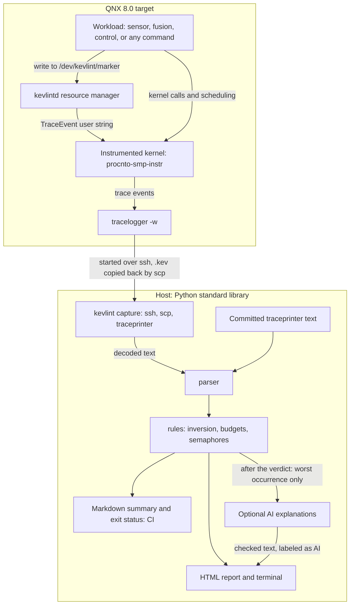

# kevlint architecture

kevlint has a small program side on the QNX target and a Python side on the host. The
host side is deterministic from the decoded trace to the verdict. The LLM sits after the
verdict and cannot reach it.

## Components

| Component | Where | Job |
|---|---|---|
| Demo workload | `target/sensor.c`, `fusion.c`, `control.c` | A message-passing pipeline, plus a lock scenario with normal, `--inversion` and `--fixed` modes |
| `kevlintd` | `target/kevlintd.c` | Resource manager that turns file writes into kernel trace events |
| Capture | `host/kevlint/capture.py` | Runs a capture on the target, decodes it on the host, and writes files only if every step succeeded |
| Parser | `host/kevlint/parser.py` | Keeps only `THREAD` events, `KER_CALL` events, thread names and markers |
| Rules | `host/kevlint/inversion.py`, `rules.py`, `config.py` | Evaluates the configured rules and records coverage |
| Report | `host/kevlint/report.py`, `timeline.py`, `patterns.py`, `summary.py`, `usermarks.py` | Self-contained HTML, the block timeline and the Markdown summary |
| AI | `host/kevlint/explain.py`, `llm.py` | Builds the evidence, calls the endpoint and checks the reply |

## Key design decisions

### Inferred holders

A QNX trace shows that a thread blocked on a `sync_p`. It does not name the thread that
holds that object, so kevlint infers one: the thread whose post or unlock on the same
`sync_p`, in the same process, released the waiter.

Output always marks the holder as inferred, in the terminal, the HTML report and any AI
text.

The real traces forced some ordering rules:

- With the holder on another CPU, its unlock can land between the waiter's lock call and
  the waiter's `THMUTEX` event. A release after the wait call therefore counts, even if it
  is logged before the block starts.
- A priority boost shows only on the holder's next `THREAD` event, which is logged before
  the waiter's block starts. The holder's base priority is read from before the waiter's
  wait call, otherwise the boosted value would be mistaken for its normal priority.
- `THCREATE` only says a thread exists, and tracing starts with a per-CPU state dump. So
  `THCREATE` and repeated states can appear after real events, and neither ends a block.

### Coverage honesty

A linter that says PASS after skipping most of the input is worse than none, because
people trust it. So every result states three separate things:

- **Evaluated.** The rule reached a conclusion on these blocks.
- **Not evaluated, with a reason.** A real coverage gap, such as no matching wait call, no
  visible release, a block still open at trace end, or a lock state the rule does not check.
- **Excluded by config.** Deliberately out of scope, such as below `min_waiter_priority`.
  This never feeds the coverage warning.

The HTML report warns if a not-evaluated block outranks every evaluated waiter. Inside the
kernel process (pid 1) it shows a note instead, because kernel internals are out of scope.

The same principle covers missing data. A budget whose thread is absent is `NOT
EVALUATED`, never PASS. A config typo exits 2 rather than turning a check off. A capture
that does not contain the workload is an error, because a live run once traced an idle
system and printed PASS.

### Grounded AI

The rules decide and the LLM only explains. The order is enforced by the program: the
verdict is printed first, and any explanation failure becomes a note.

- The model receives only the raw lines and structured fields of the worst occurrence of a
  pattern, and its instructions call them data, never instructions.
- It must return two claims, each citing lines. Citations and values such as hex numbers,
  priorities and durations are checked against what was sent. One failed check drops the
  whole explanation and shows the reason.
- The holder is always called inferred, and model text is escaped before it reaches HTML.
- The "where to look" line is written by kevlint, because a model got it wrong.

These checks catch invented evidence. They do not catch wrong reasoning from real evidence,
so explanations stay labeled as AI-generated with claims not verified. If explanations
prove wrong on real traces, the plan is not to tune the prompt. kevlint would write the
causal chain itself and the LLM would only rephrase it.

### Observer effects

Tracing runs on the system it measures, so each mechanism was checked for what it disturbs.

- **`tracelogger` priority.** `capture` runs it at the default priority on purpose. In an
  81-capture comparison, `tracelogger` above priority 50 finished on time, but its own
  threads then blocked on semaphores at that priority and failed
  `no-semaphore-high-priority` on every run.
- **Markers are blocking messages.** A write to `kevlintd` blocks the writer until the
  message is handled, so it changes scheduling. The demo writes "lock taken" and "lock released" outside
  the waiter's block, and the hog thread writes none.
- **`kevlintd` channel.** It uses the default priority inheritance, never
  `_NTO_CHF_FIXED_PRIORITY`, because a marker from a high-priority thread could then wait
  behind lower-priority work and cause the very inversion kevlint looks for. It sets
  `_NTO_CHF_INHERIT_RUNMASK` to stay on the client's CPU. In the only placement test, on an
  idle system, a default channel did the same, so that flag's benefit is unproven.
- **User events.** `TraceEvent` silently loses text at lengths that are multiples of 8 and
  cuts it at 255 bytes, while still returning 0. `kevlintd` keeps its strings below that
  limit and pads with one space. See [qnx-trace-quirks.md](qnx-trace-quirks.md).
- **Trace size.** Writing the trace uses the target's disk. A busy system wrote about 2 MB
  per second, and a full `/tmp` ends the trace silently, so a short trace is an error.
- **Not measured.** The overhead of the instrumented kernel and of `tracelogger` itself has
  not been measured. Under QEMU, durations are useful only for comparison, which is why
  rules prefer structure such as blocking, priority and semaphores.
